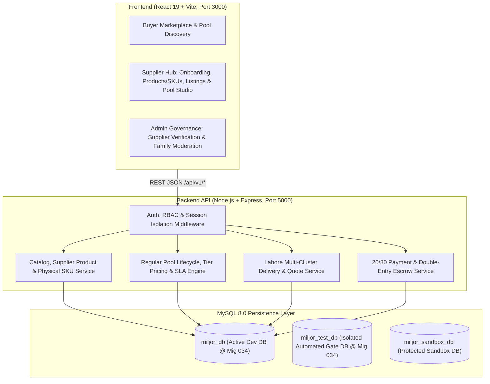

# MILJOR — MASTER SYSTEM BIBLE & ARCHITECTURAL INDEX
**Project:** MilJor — Lahore-First B2B Collective Food Procurement Marketplace  
**Repository:** `umarjameel12/miljor-b2b-marketplace`  
**Branch:** `feature/package-e`  
**Active Schema Version:** Migration `034` (`034_supplier_owned_products_skus_and_immutable_pools.sql`)  
**Last Updated:** 2026-11-10

---

## 1. Executive Summary & Marketplace Vision

MilJor is a Lahore-first B2B collective food procurement marketplace engineered to connect verified wholesale food suppliers, mills, importers, and processors with commercial food buyers (restaurants, cloud kitchens, caterers, hostels, bakeries, and institutional kitchens).

### Core Value Proposition
1. **Collective Demand Aggregation (Regular Pools):** Suppliers publish time-bounded wholesale procurement pools with volume-based tiered pricing. Multiple buyers reserve quantities into the same pool. As combined buyer volume crosses higher tier thresholds, the unit price drops retroactively for every participating buyer in the pool.
2. **Physical Commodity Precision:** Every listing and pool is anchored to an exact 6-level canonical product and physical packaging hierarchy (`Category -> Canonical Product Family -> Supplier-Owned Product -> Physical SKU -> Commercial Listing -> Regular Pool`). Mass (`kg`, `g`) and volume (`L`, `mL`) are strictly segregated.
3. **Supplier Sovereignty & Commercial Immutability:** Only the verified owning supplier may create, configure, or publish a product SKU, commercial listing, or Regular Pool. Once a SKU or Regular Pool is published, its identity, pricing tiers, MOQs, participation cutoff, promised delivery SLA (`+24h` to `+72h`), and delivery cluster coverage are permanently locked.
4. **Escrow-Backed Two-Stage Settlement:** Buyers place a 20% reservation commitment upon pool threshold locking, followed by an 80% final settlement prior to dispatch/pickup, backed by double-entry escrow ledger accounting and dispute hold protection.

---

## 2. Master Documentation Index

| # | Document | File Path | Domain Scope |
|---|---|---|---|
| 1 | **Master System Bible** | `backend/docs/MILJOR_MASTER_SYSTEM_BIBLE.md` | High-level system architecture, domain map, invariants index, and operational topology |
| 2 | **Business Invariants Ledger** | `backend/docs/MILJOR_BUSINESS_INVARIANTS.md` | Canonical non-negotiable business rules across catalog, pools, pricing, delivery, escrow, and security |
| 3 | **Product Catalog & SKU Architecture** | `backend/docs/MILJOR_PRODUCT_CATALOG_AND_SKU_ARCHITECTURE.md` | 6-level hierarchy, optional brand/grade rules, `25kg` vs `50kg` SKU separation, mass vs volume rules, catalog request workflow |
| 4 | **Regular Pools End-to-End Specification** | `backend/docs/MILJOR_REGULAR_POOLS_END_TO_END_SPECIFICATION.md` | Rules P1–P13, supplier-only creation/publishing, `is_terms_locked=1` immutability even at 0 reservations, 24–72h delivery SLA |
| 5 | **Delivery & Fulfillment Specification** | `backend/docs/MILJOR_DELIVERY_AND_FULFILLMENT_SPECIFICATION.md` | Lahore geographic clusters, `STANDARD_CLUSTERED`, `EXPRESS`, `PICKUP`, quote lifecycle, and pool SLA alignment |
| 6 | **Supplier Lifecycle & Entitlements** | `backend/docs/MILJOR_SUPPLIER_LIFECYCLE_AND_ENTITLEMENTS_SPECIFICATION.md` | Onboarding, AES-256-GCM encrypted IBAN, admin verification, plan caps (`STARTER=4`, `GROWTH=13`, `BUSINESS=25`), E3 readiness |
| 7 | **Buyer Lifecycle Specification** | `backend/docs/MILJOR_BUYER_LIFECYCLE_SPECIFICATION.md` | Minimal registration (`base_cluster_id`), OTP verification, multi-address management, pool discovery, reservations, commitments |
| 8 | **Payments, Escrow & Settlement** | `backend/docs/MILJOR_PAYMENTS_ESCROW_AND_SETTLEMENT_SPECIFICATION.md` | 20%/80% two-stage payment model, JazzCash/EasyPaisa/Bank Transfer, double-entry ledger, refunds, supplier payouts |
| 9 | **Security, Privacy & Compliance** | `backend/docs/MILJOR_SECURITY_PRIVACY_AND_COMPLIANCE_SPECIFICATION.md` | RBAC, session isolation, JWT/OTP auth, AES-256-GCM banking encryption, response field allowlists, audit trails |
| 10 | **Database Dictionary & Migration Ledger** | `backend/docs/MILJOR_DATABASE_DICTIONARY_AND_MIGRATION_LEDGER.md` | Complete MySQL 8 table dictionary, foreign keys, indexes, and Migrations `001`–`034` ledger |
| 11 | **API Contract Reference** | `backend/docs/MILJOR_API_CONTRACT_REFERENCE.md` | Full REST API endpoint catalog (`/api/v1/*`), auth guards, request/response schemas, and deterministic error codes |
| 12 | **Frontend Screen & State Map** | `backend/docs/MILJOR_FRONTEND_SCREEN_AND_STATE_MAP.md` | React 19 + Vite route topology, role guards, supplier catalog/pool studio workflows, buyer marketplace UX |
| 13 | **Test Gate & Verification Matrix** | `backend/docs/MILJOR_TEST_GATE_AND_VERIFICATION_MATRIX.md` | Isolated test suite catalog on `miljor_test_db`, assertion coverage, and zero-pollution database verification |

---

## 3. System Architecture & Runtime Topology

---

## 4. Core Domain Hierarchy & Entity Relationships

1. **Identity & Governance Layer:**
   - `users`: Buyers, Suppliers, Admins (`role IN ('BUYER', 'SUPPLIER', 'ADMIN')`).
   - `supplier_profiles`: Legal business details, NTN/STRN, AES-256-GCM encrypted `bank_iban` (`v1:iv:tag:ciphertext`), `verification_status`, `subscription_plan` (`STARTER`, `GROWTH`, `BUSINESS`), `max_active_listings` (`4`, `13`, `25`).
   - `buyer_delivery_addresses` & `lahore_clusters`: Geographic cluster assignment (`base_cluster_id`) and voluntary delivery addresses.

2. **6-Level Catalog & Commercial Layer:**
   - **Level 1 (`canonical_categories`):** 8 Admin-governed top-level B2B food categories.
   - **Level 2 (`canonical_product_families`):** Admin-governed canonical commodity families (e.g., `Rice`, `Cooking Oil`, `Banaspati Ghee`, `Refined Sugar`, `Gur / Jaggery`) defining `measurement_dimension` (`MASS`, `VOLUME`, `COUNT`) and `allowed_units_json`.
   - **Level 3 (`supplier_products`):** Supplier-owned product definitions (`is_unbranded`, optional `brand`, `variety`, optional `quality_grade`, optional `processing_method`, `status` `DRAFT | PUBLISHED | ARCHIVED`).
   - **Level 4 (`supplier_skus` & `product_specifications`):** Supplier-owned physical packaging SKUs (`packaging_type`, `pack_size`, `pack_unit`, `purchasing_unit`). Separate pack sizes (`25kg` vs `50kg`) are separate physical SKUs. Publishing a SKU atomically links a bridge row in `product_specifications` (`supplier_sku_id`) for downstream compatibility.
   - **Level 5 (`supplier_listings`):** Commercial offers (`unit_price`, `min_order_qty`, `available_stock`, `lead_time_days`, `status`) created by `VERIFIED` suppliers for a published SKU.
   - **Level 6 (`pools`, `pool_price_tiers`, `pool_delivery_clusters`):** Supplier-created Regular Pools with monotonic volume discount tiers, explicit Lahore delivery clusters, participation cutoff (`scheduled_close_at`), and mandatory supplier-defined delivery SLA (`promised_delivery_at` within `[scheduled_close_at + 24h, scheduled_close_at + 72h]`).

---

## 5. Database Governance Rules

- **Never run `backend/database/schema.sql`** against any existing database (`schema.sql` contains `DROP DATABASE IF EXISTS miljor_db`).
- **All automated test gates** force `process.env.NODE_ENV = 'test'` and `process.env.TEST_DB_NAME = 'miljor_test_db'`, cleaning up their own fixtures and verifying zero test-data pollution in `miljor_db`.
- **`miljor_db` activation** follows a strict backup -> temporary recovery DB parity check -> ordered forward migration protocol (`032` -> `033` -> `034`).
