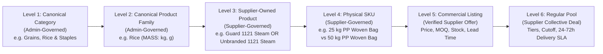

# MILJOR — PRODUCT CATALOG & SUPPLIER SKU ARCHITECTURE SPECIFICATION
**Document ID:** `MILJOR-DOC-CAT-034`  
**Active Migration:** `034_supplier_owned_products_skus_and_immutable_pools.sql`  
**Status:** Production Baseline (Package E2 Finalized)

---

## 1. The 6-Level Product & Packaging Hierarchy

MilJor enforces a strict 6-level separation between platform-governed taxonomy and supplier-owned commercial products:

---

## 2. Canonical Taxonomy Rules (Levels 1 & 2)

### 2.1 Canonical Categories (`catalog_categories`)

These are the **actual eight initial food categories** seeded in migration 033. The platform can approve more categories later; eight is not a hardcoded global ceiling.

1. `Grains & Rice` (`grains-rice`)
2. `Cooking Oils & Ghee` (`cooking-oils-ghee`)
3. `Flour & Milling Products` (`flour-milling-products`)
4. `Pulses & Legumes` (`pulses-legumes`)
5. `Sugar & Sweeteners` (`sugar-sweeteners`)
6. `Spices & Seasonings` (`spices-seasonings`)
7. `Tea & Beverages` (`tea-beverages`)
8. `Bakery Ingredients` (`bakery-ingredients`)

**Launch exclusion:** HoReCa packaging, tissue, boxes and disposables are **not** initial launch-facing product categories. Do not substitute them for Bakery Ingredients or insert them automatically. Historical data must still be preserved.

**B1 owner separation:** MilJor approves only category/family taxonomy. Every supplier owns their product identity, grade, brand, packaging, pack quantity and physical SKU. Ordinary new SKUs under existing approved families do not require new-variant approval.

### 2.2 Canonical Product Families (`catalog_product_families`)
- **Commodity Consolidation & Separation:**
  - Both *Basmati Rice* and *Non-Basmati Rice* belong to the single canonical **`Rice`** family (`slug = 'rice'`, `measurement_dimension = 'MASS'`, `allowed_units_json = ["kg", "g"]`).
  - Both *Cooking Oil* and *Commercial Cooking Oil* belong to **`Cooking Oil`** (`slug = 'cooking-oil'`, `measurement_dimension = 'VOLUME'`, `allowed_units_json = ["L", "mL"]`), strictly separate from **`Banaspati Ghee`** (`slug = 'banaspati-ghee'`).
  - **`Refined Sugar`** (`slug = 'refined-sugar'`) and **`Gur / Jaggery`** (`slug = 'gur-jaggery'`) are strictly separate canonical families under `Sugar, Sweeteners & Jaggery`.
- **Missing Family Governance:**
  - Suppliers cannot directly create canonical categories or families (`POST /api/v1/products` and `POST /api/v1/specifications` are restricted from suppliers with `403 DIRECT_CATALOG_CREATION_PROHIBITED`).
  - If a canonical product family is missing, a supplier submits a `NEW_FAMILY` request (`POST /api/v1/catalog/requests`), which an Admin reviews and approves (`POST /api/v1/admin/catalog/requests/:id/approve`).

---

## 3. Supplier-Owned Product Rules (Level 3 — `supplier_products`)

### 3.1 Brand Is Optional (`is_unbranded`)
- Suppliers sell both branded goods (e.g., *Guard*, *Sufi*, *Dalda*) and unbranded wholesale/mill-direct commodities (e.g., *Unbranded 1121 Steam Basmati Rice*, *Unbranded Peshawari Gur*).
- When `is_unbranded = true` (`1`):
  - `brand` is stored as `NULL` in MySQL (never forced to a fake string).
  - Display title uses `Unbranded <variety>` cleanly.
- When `is_unbranded = false` (`0`):
  - A non-empty `brand` string is required (`400 BRAND_REQUIRED_UNLESS_UNBRANDED`).

### 3.2 Quality Grade & Processing Method Are Optional
- `quality_grade` and `processing_method` are nullable (`NULL` when omitted).
- The backend **never** injects artificial default grades (such as `'Standard'`, `'Grade A'`, or `'N/A'`) when a supplier leaves `quality_grade` blank.

### 3.3 Supplier Ownership & Lifecycle
- Every row in `supplier_products` belongs to `supplier_id`.
- Lifecycle states: `DRAFT -> PUBLISHED -> ARCHIVED`.
- While in `DRAFT`, the owning supplier may edit `brand`, `is_unbranded`, `variety`, `quality_grade`, `processing_method`, `origin_country`, `origin_region`, `description`, `certifications_json`, and `dietary_flags_json`.
- Once any child SKU is published (or the product transitions to `PUBLISHED`), the core identity of the product (`family_id`, `brand`, `is_unbranded`, `variety`, `quality_grade`, `processing_method`) is permanently locked (`422 SUPPLIER_PRODUCT_IMMUTABLE`).

---

## 4. Physical SKU Rules (Level 4 — `supplier_skus`)

### 4.1 Distinct Pack Sizes Are Separate Physical SKUs
- A `25 kg PP Woven Bag` and a `50 kg PP Woven Bag` under the same `supplier_product` are **separate rows** in `supplier_skus` with distinct `sku_code`, `canonical_hash`, inventory allocations, commercial listings, and pools.

### 4.2 Strict Mass vs Volume Dimensional Separation
- `pack_size` must be a finite positive number (`> 0`).
- `pack_unit` is validated against the parent canonical family's `measurement_dimension` and `allowed_units_json`:
  - `MASS` families (`Rice`, `Wheat Flour / Atta`, `Refined Sugar`, `Gur / Jaggery`, `Pulses`): allow `kg`, `g`. Submitting `L` or `mL` fails with `400 INCOMPATIBLE_FAMILY_UNIT`.
  - `VOLUME` families (`Cooking Oil`): allow `L`, `mL`. Submitting `kg` or `g` fails with `400 INCOMPATIBLE_FAMILY_UNIT`.

### 4.3 SKU Lifecycle & Bridge Synchronization
- **Draft Creation (`POST /api/v1/catalog/supplier-skus`):** Any authenticated `SUPPLIER` (including unverified onboarding suppliers) may create and edit SKUs in `DRAFT`.
- **Publishing (`POST /api/v1/catalog/supplier-skus/:id/publish`):**
  - Transitions the SKU to `PUBLISHED` (`published_at = NOW()`).
  - Transitions the parent `supplier_product` to `PUBLISHED` if still in `DRAFT`.
  - Atomically links or creates a bridge row in `product_specifications` (`supplier_sku_id = sku.id`, `approval_status = 'APPROVED'`) so all existing commercial listings, pools, and comparison queries work seamlessly.
- **Immutability After Publish:**
  - Calling `PUT /api/v1/catalog/supplier-skus/:id` on a `PUBLISHED` or `ARCHIVED` SKU is rejected with `422 SKU_IMMUTABLE_AFTER_PUBLISH`.
  - If a supplier needs a different pack size or packaging type after publishing, they must create a new SKU.
- **Archiving (`POST /api/v1/catalog/supplier-skus/:id/archive`):**
  - Transitions a SKU to `ARCHIVED` (`archived_at = NOW()`) so it cannot be used for new listings or pools, while preserving historical pool and order references.

---

## 5. Commercial Listing Rules (Level 5 — `supplier_listings`)

- Only a `VERIFIED` supplier (`supplier_profiles.verification_status = 'VERIFIED'`) may create or activate a commercial listing (`POST /api/v1/listings`). Unverified suppliers receive `403 SUPPLIER_NOT_VERIFIED`.
- Accepts either `supplier_sku_id` (resolving its linked `product_spec_id` and asserting cross-supplier ownership if the SKU is private) or `product_spec_id`.
- Enforces positive `unit_price`, positive `min_order_qty`, non-negative `available_stock`, and records every price change in `listing_price_history`.
