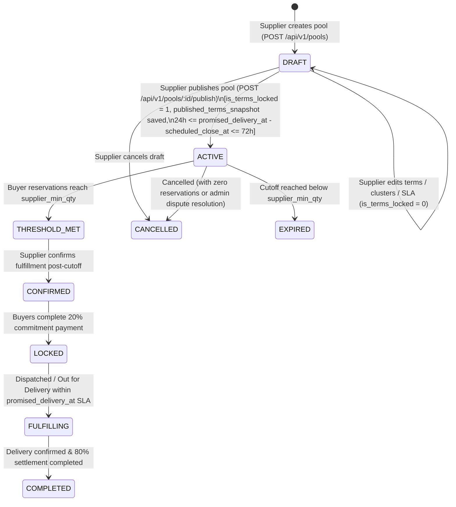

# MILJOR — REGULAR POOLS END-TO-END SPECIFICATION (RULES P1–P13)
**Document ID:** `MILJOR-DOC-POOL-034`  
**Active Migration:** `034_supplier_owned_products_skus_and_immutable_pools.sql`  
**Status:** Production Baseline (Package E2 Finalized)

---

## 1. Domain Definition

A **Regular Pool** is a supplier-owned, time-bounded collective B2B wholesale offering for a specific published physical SKU and active supplier listing. Multiple buyers join the pool by reserving quantities before `scheduled_close_at`. As total reserved quantity (`current_qty`) increases across the pool's contiguous volume discount tiers (`pool_price_tiers`), the active unit price decreases for **all** participating buyers in the pool.

---

## 2. Canonical Regular Pool Invariants (Rules P1–P13)

| Rule | Invariant Name | Enforcement Specification |
|---|---|---|
| **P1** | **Supplier-Only Pool Creation & Publishing** | Only an authenticated user with `role = 'SUPPLIER'` and `verification_status = 'VERIFIED'` who owns the underlying `supplier_listing` may create (`POST /api/v1/pools`), edit in draft (`PUT /api/v1/pools/:id`), configure delivery clusters (`PUT /api/v1/pools/:id/clusters`), or publish (`POST /api/v1/pools/:id/publish`) a Regular Pool. Any `ADMIN` or non-owning `SUPPLIER` attempt is rejected with `403 FORBIDDEN` (`subcode: 'SUPPLIER_CONSENT_REQUIRED'` for Admin). |
| **P2** | **Draft Mutability Before Publish** | While `status = 'DRAFT'` and `is_terms_locked = 0`, the owning supplier may freely update `title`, `description`, `supplier_min_qty`, `buyer_min_qty`, `max_capacity`, `scheduled_close_at` (`expires_at`), `promised_delivery_at`, `pickup_available`, `pickup_location_note`, `price_tiers`, and `delivery_cluster_ids`. |
| **P3** | **Permanent Commercial Immutability Upon Publish** | Publishing (`POST /api/v1/pools/:id/publish`) atomically sets `status = 'ACTIVE'`, `published_at = NOW()`, `published_by = supplier_id`, `is_terms_locked = 1`, `terms_locked_at = NOW()`, and captures a complete JSON snapshot in `published_terms_snapshot`. Once published, `PUT /api/v1/pools/:id` and `PUT /api/v1/pools/:id/clusters` are **unconditionally rejected** with `422 POOL_TERMS_IMMUTABLE` (`subcode: 'PUBLISHED_POOL_LOCKED'`), **even when the pool has zero buyer reservations**. |
| **P4** | **Locked Fields on Published Pools** | The following fields can never be altered after publish: `supplier_id`, `product_id`, `product_spec_id`, `supplier_sku_id`, `listing_id`, `unit`, `packaging_type`, `pack_size`, `pack_unit`, `base_unit_price`, `moq` / `supplier_min_qty`, `buyer_min_qty`, `max_capacity`, `scheduled_close_at` / `expires_at`, `promised_delivery_at`, `delivery_lead_days`, `pickup_available`, `pickup_location_note`, `coverage_policy`, `pool_price_tiers`, and `pool_delivery_clusters`. |
| **P5** | **Dynamic System-Managed State After Publish** | Only runtime progress and lifecycle state managed by the transactional pool engine may change after publish: `current_qty` (via buyer reservations/cancellations), active tier calculation, `status` transitions (`ACTIVE -> THRESHOLD_MET -> CONFIRMED -> LOCKED -> FULFILLING -> COMPLETED` or `EXPIRED / CANCELLED`), and system timestamps. |
| **P6** | **Mandatory Supplier-Defined Promised Delivery Timestamp** | Every Regular Pool must have an explicit supplier-defined `promised_delivery_at` (`DATETIME`) before it can be published. Attempting to publish a pool with `promised_delivery_at = NULL` fails with `422 PROMISED_DELIVERY_REQUIRED` (`subcode: 'MISSING_DELIVERY_SLA'`). |
| **P7** | **Strict 24-to-72 Hour (1–3 Day) Delivery SLA Window** | `promised_delivery_at` is measured relative to the pool participation cutoff (`scheduled_close_at` / `expires_at`) and must satisfy: `scheduled_close_at + 24 hours <= promised_delivery_at <= scheduled_close_at + 72 hours` (inclusive, with 1-second MySQL `DATETIME` precision). Offsets `< 24h` fail with `422 DELIVERY_SLA_OUT_OF_RANGE` (`DELIVERY_SLA_TOO_EARLY`); offsets `> 72h` fail with `422 DELIVERY_SLA_OUT_OF_RANGE` (`DELIVERY_SLA_TOO_LATE`); timestamps `<= scheduled_close_at` fail with `DELIVERY_BEFORE_POOL_CLOSE`. |
| **P8** | **Delivery Cluster Coverage Lock** | Before publishing (unless `pickup_available = 1` with pickup-only policy), the supplier must assign valid active Lahore clusters (`pool_delivery_clusters`). Upon publish, `pool_delivery_clusters` is permanently locked (`422 POOL_TERMS_IMMUTABLE`). |
| **P9** | **Monotonic Contiguous Price Tiers** | Price tiers (`pool_price_tiers`) must start at `min_qty = 1`, have contiguous non-overlapping boundaries, and strictly non-increasing `price_per_unit` as volume increases (`tierPricingService.validatePriceTiers`). |
| **P10** | **Inventory Allocation Lock on Publish** | Publishing a pool creates an `ACTIVE` hold in `supplier_inventory_allocations` for `max_capacity` against the supplier's listing stock. |
| **P11** | **Retroactive Tier Price Application** | When new buyer reservations push `current_qty` into a higher volume tier, the lower `price_per_unit` applies to all reservations in that pool (`poolProgressService`). |
| **P12** | **Concurrency Serialization (`SELECT ... FOR UPDATE`)** | Both `updateDraftPool` (`PUT /api/v1/pools/:id`), `updatePoolClusters` (`PUT /api/v1/pools/:id/clusters`), and `publishPool` (`POST /api/v1/pools/:id/publish`) acquire a row-level `SELECT ... FOR UPDATE` lock on `pools WHERE id = ?` inside an explicit MySQL transaction, preventing race conditions between concurrent draft edits and publishing. |
| **P13** | **Controlled Cancellation Semantics** | An active pool with zero reservations may be cancelled by its owning supplier via the dedicated cancellation flow (`POST /api/v1/pools/:id/cancel`), transitioning `status = 'CANCELLED'` and releasing the inventory allocation—never by mutating commercial terms in place. |

---

## 3. Regular Pool State Machine



---

## 4. `published_terms_snapshot` Structure

When `POST /api/v1/pools/:id/publish` executes, the exact commercial contract is serialized into `pools.published_terms_snapshot` (`JSON`):

```json
{
  "pool_id": 104,
  "pool_code": "MJ-POOL-0104",
  "supplier_id": 2,
  "product_id": 1,
  "product_spec_id": 1,
  "supplier_sku_id": 1,
  "listing_id": 1,
  "title": "1121 Steam Basmati Rice — 25kg Bag Wholesale Pool",
  "unit": "bag",
  "base_unit_price": 6800,
  "supplier_min_qty": 20,
  "buyer_min_qty": 2,
  "max_capacity": 100,
  "scheduled_close_at": "2026-11-12T12:00:00.000Z",
  "promised_delivery_at": "2026-11-14T12:00:00.000Z",
  "delivery_lead_days": 2,
  "supplier_confirmation_deadline": "2026-11-13T12:00:00.000Z",
  "buyer_commitment_deadline": "2026-11-14T12:00:00.000Z",
  "coverage_policy": "EXPLICIT_CLUSTERS",
  "pickup_available": true,
  "pickup_location_note": "Akbari Mandi Warehouse Gate 2, Lahore",
  "delivery_cluster_ids": [1, 2, 4],
  "price_tiers": [
    { "tier_number": 1, "min_qty": 1, "max_qty": 19, "price_per_unit": 6800, "discount_pct": 0 },
    { "tier_number": 2, "min_qty": 20, "max_qty": 49, "price_per_unit": 6500, "discount_pct": 4.41 },
    { "tier_number": 3, "min_qty": 50, "max_qty": null, "price_per_unit": 6200, "discount_pct": 8.82 }
  ],
  "locked_at": "2026-11-10T12:00:00.000Z",
  "locked_by": 2
}
```
