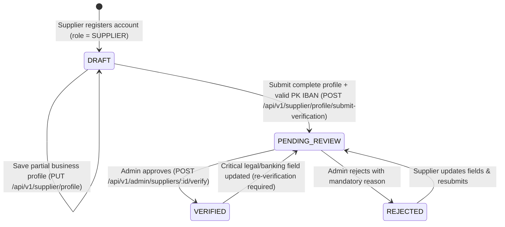

# MILJOR — SUPPLIER LIFECYCLE, VERIFICATION & ENTITLEMENTS SPECIFICATION
**Document ID:** `MILJOR-DOC-SUPP-034`  
**Active Migration:** `034_supplier_owned_products_skus_and_immutable_pools.sql`  
**Status:** Production Baseline (Package E1 & E2 Finalized; E3 Not Yet Started)

---

## 1. Supplier Onboarding & Verification State Machine

---

## 2. Mandatory Onboarding Validations (`supplier_profiles`)

1. **Pakistani Phone Number:** Normalized and validated (`+923XXXXXXXXX` or `03XXXXXXXXX`).
2. **NTN (National Tax Number):** Validated Pakistani 7-digit + 1 check-digit format (`XXXXXXX-X`).
3. **Pakistani IBAN (`PKkkBBBBAAAAAAAAAAAAAAAA`):**
   - 24-character Pakistani IBAN format (`^PK\d{2}[A-Z0-9]{4}\d{16}$`) verified via **ISO 13616 Modulo-97 checksum validation**.
   - **Encrypted at Rest:** Stored exclusively using **AES-256-GCM** authenticated encryption (`v1:<iv_hex>:<authTag_hex>:<ciphertext_hex>`) via `encryptionService.js` using `BANK_DATA_ENCRYPTION_KEY`.
   - **Fail-Closed Security:** Missing or invalid `BANK_DATA_ENCRYPTION_KEY` fails closed without logging or persisting plaintext. Normal application reads reject unencrypted legacy strings (`allowLegacy: false`).
   - **Masked Exposure Only:** Normal supplier profile responses and admin review queues expose only `bank_iban_masked` (e.g., `PK36SCBL************1234`) and `bank_iban_configured: true`.

---

## 3. Role-Gated Capabilities by Verification Status

| Capability | `DRAFT` / `PENDING_REVIEW` / `REJECTED` Supplier | `VERIFIED` Supplier |
|---|---|---|
| Edit own business profile (`PUT /api/v1/supplier/profile`) | Allowed | Allowed |
| Submit missing product family request (`POST /api/v1/catalog/requests`) | Allowed | Allowed |
| Create & edit Supplier-Owned Products (`POST/PUT /api/v1/catalog/supplier-products`) | Allowed | Allowed |
| Create, edit & publish Physical SKUs (`POST/PUT /api/v1/catalog/supplier-skus`) | Allowed | Allowed |
| Create or activate Commercial Listings (`POST /api/v1/listings`) | **Blocked (`403 SUPPLIER_NOT_VERIFIED`)** | Allowed |
| Create, edit or publish Regular Pools (`POST /api/v1/pools`, `POST /api/v1/pools/:id/publish`) | **Blocked (`403 SUPPLIER_NOT_VERIFIED`)** | Allowed |

---

## 4. Subscription Tier Caps (Server-Side Enforced)

During admin verification (`POST /api/v1/admin/suppliers/:id/verify`), the server strictly maps `subscription_plan` to its canonical `max_active_listings` cap and ignores any inflated client-supplied slot counts:

| Plan Code | Canonical Active Listing Cap (`max_active_listings`) | Verification Level Support |
|---|---|---|
| **`STARTER`** (Default / Free) | **`4`** | `BASIC`, `VERIFIED`, `PREMIUM_PARTNER` |
| **`GROWTH`** | **`13`** | `BASIC`, `VERIFIED`, `PREMIUM_PARTNER` |
| **`BUSINESS`** | **`25`** | `BASIC`, `VERIFIED`, `PREMIUM_PARTNER` |

*(Note: Full Package E3 subscription billing and entitlement enforcement engine is scheduled for Package E3; current server-side caps prevent privilege inflation during E1/E2.)*
